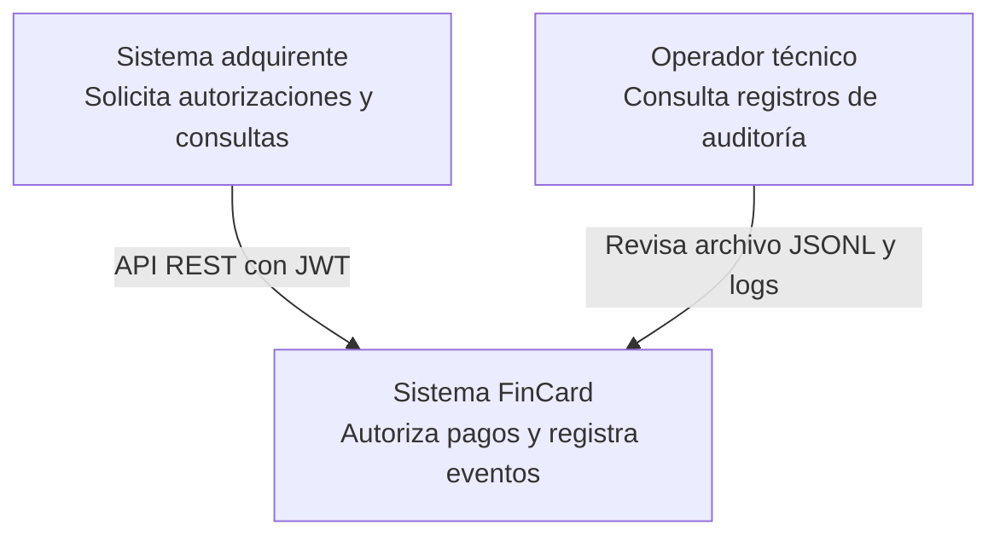

# C4 — Nivel 1: Contexto

FinCard permite autorizar pagos, consultar saldo y cupo, y registrar
la auditoría de las transacciones aprobadas.

Alcance del prototipo: tarjetas ficticias, autorización local y auditoría.
No existe conexión con una red de pagos real.
