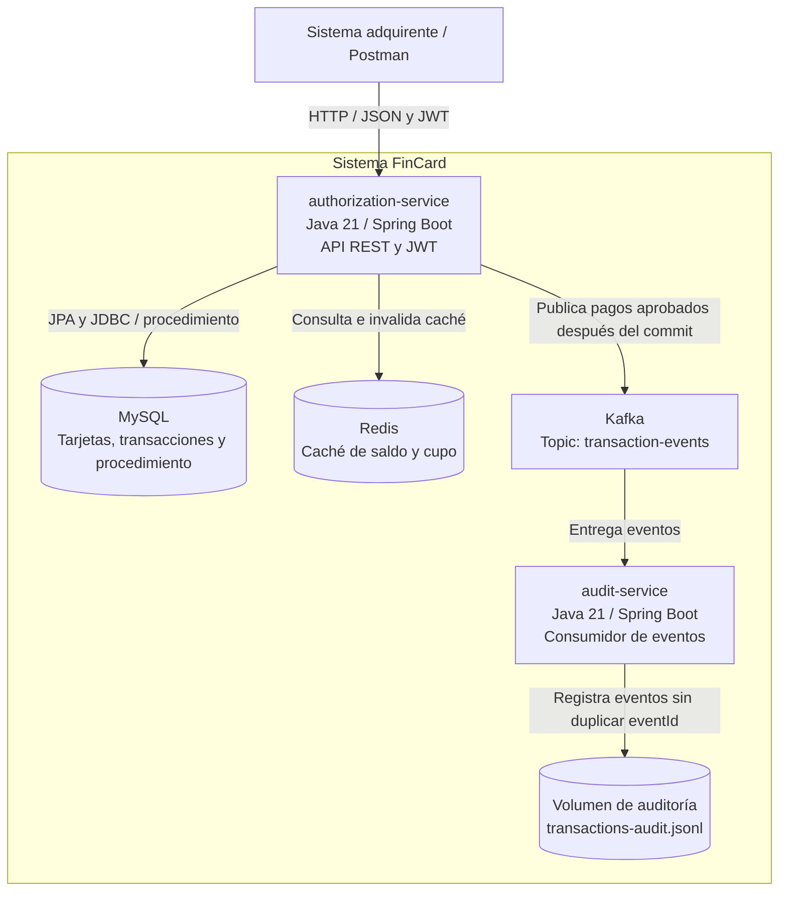

# C4 — Nivel 2: Contenedores

MySQL puede ejecutarse en el equipo anfitrión o mediante el Compose
opcional. El servicio de auditoría no expone una API HTTP.

La publicación directa a Kafka después del commit no garantiza entrega
si ocurre un fallo entre la confirmación de MySQL y la publicación.
Queda como mejora para producción reintentos y mejor configuracion apra el servicio de auditoria y Notificacion.