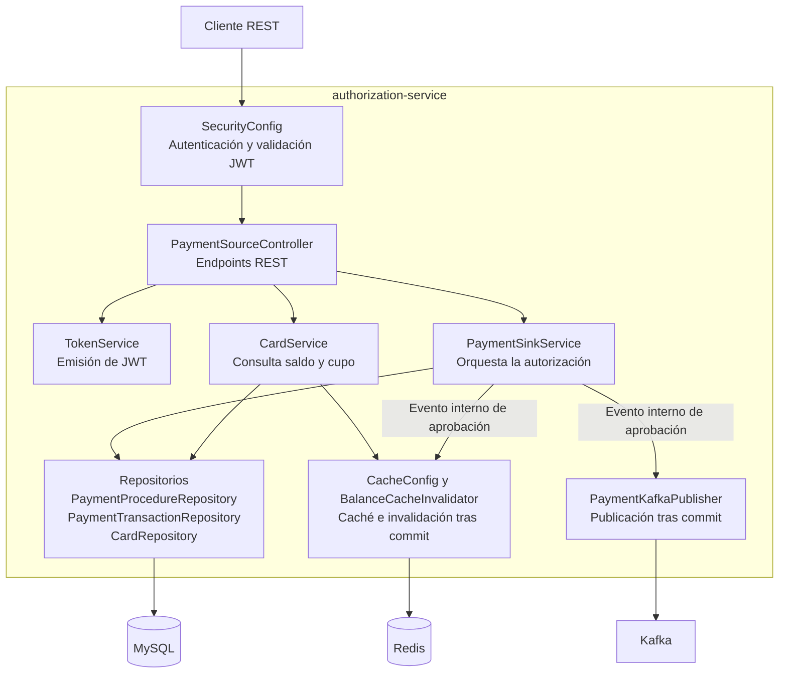

# C4 — Nivel 3: Componentes de autorización

PaymentSinkService coordina, dentro de una transacción de Spring,
la llamada al procedimiento almacenado y el registro del movimiento.

El procedimiento bloquea la tarjeta durante la autorización mediante
SELECT FOR UPDATE y actualiza su saldo. La transacción se confirma
cuando finaliza correctamente el servicio.

Después del commit, los listeners invalidan la caché de saldo y
publican el evento aprobado en Kafka.